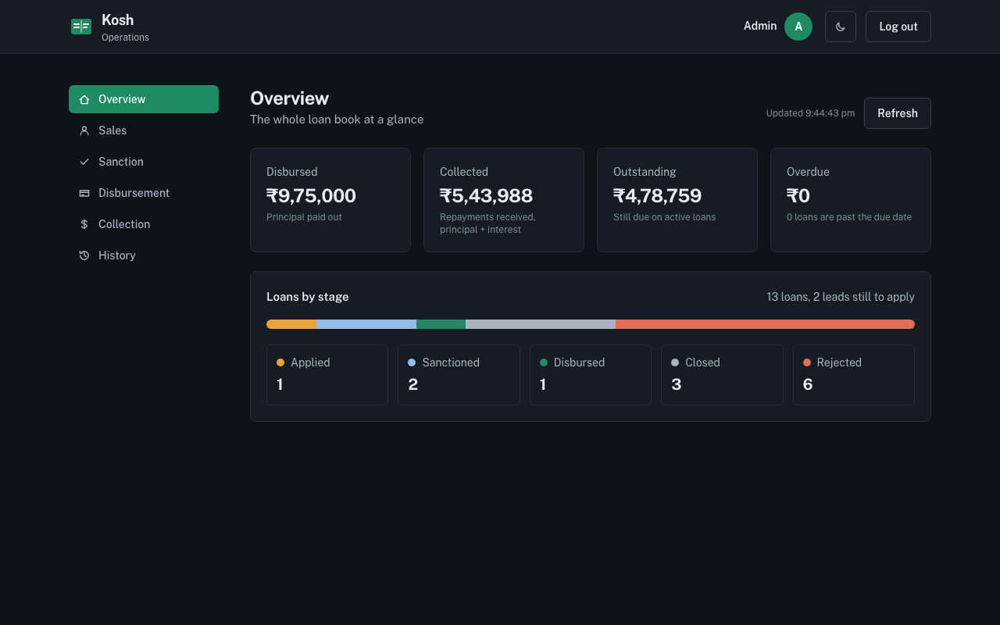

# Kosh — Loan Management System

> A loan management system: a borrower applies online, and four internal teams take the loan from application to closure, with every decision recorded.

**[Live demo](https://kosh-lms.vercel.app)** · **[Demo video](https://www.youtube.com/watch?v=D0_4UIqaj7g)** · **[API docs](https://kosh-lms.vercel.app/api/docs)** · Login `admin@lms.dev` / `Password@123`

**Stack:** Next.js 16 · React 19 · TypeScript · Express 5 · MongoDB · AWS S3 · Vercel

## At a glance

- **Correct under concurrency:** the loan lifecycle is an explicit state machine with conditional atomic updates, so two officers acting at once can never both approve or disburse a loan; a partial unique index allows one open loan per borrower.
- **Money handled safely:** amounts stored as integer paise, simple interest computed on the server, repayments keyed by a unique UTR so a resubmitted payment is never counted twice, and reversals that reopen a closed loan.
- **Access and audit:** five roles enforced in the API and the UI; every approval, rejection, payment and reversal lands in a per-loan timeline with who, when and why.
- **Built to run:** salary slips upload straight to a private S3 bucket through presigned requests (avoiding Vercel's 4.5 MB body limit), and moving the API next to the database cut response time from about 1.1 s to 0.15 s.
- **Tested:** 271 automated tests (190 API, 81 UI).



---

## Overview

A lending platform where borrowers apply for personal loans and internal teams take each loan through its lifecycle:
**Applied → Sanctioned → Disbursed → Closed** (or **Rejected**).

- **Borrower portal**: sign up, personal details with a server-side eligibility check (BRE), salary-slip upload, and a loan configurator with a live simple-interest calculation.
- **Operations dashboard**: four modules (Sales, Sanction, Disbursement, Collection). Each executive sees only their own module and Admin sees all four. Access is enforced in the UI and by the API.

**Demo video:** [watch on YouTube](https://www.youtube.com/watch?v=D0_4UIqaj7g). One loan end to end: a borrower applies (BRE fail and pass), it is sanctioned, disbursed, repaid, and closes.

[](https://www.youtube.com/watch?v=D0_4UIqaj7g)

| Layer    | Stack |
|----------|-------|
| Frontend | Next.js 16 (App Router), React 19, TypeScript, Tailwind CSS 4 |
| Backend  | Node.js, Express 5, TypeScript, Zod |
| Database | MongoDB + Mongoose |
| Auth     | JWT (httpOnly cookie) + bcrypt |
| Tests    | Vitest, supertest, mongodb-memory-server, Testing Library |

## Beyond the brief

Everything the assignment asks for is implemented as specified. These additions build on it:

| Area | What it adds |
|---|---|
| **What was checked** | Each loan keeps the checks run at application (age, salary, PAN, employment, salary slip) with the values seen. Reviewers see it before approving; borrowers see it on their loan. |
| **Reasons at every decision** | Sanction approve takes an optional remark. Reject needs a category the borrower sees (income mismatch, unreadable slip, and so on) plus an optional note. Disbursement needs the bank transfer reference, and can also **reject** a sanctioned loan with a reason (bank details failed, KYC, borrower withdrew). |
| **Payment reversal** | Collection can reverse a bounced or mistaken payment with a reason. The payment stays in the record as reversed (its UTR stays used), the balance goes back up, and a loan that payment had closed is reopened. Collection also has a Closed tab. |
| **History** | Every loan has a timeline: status changes, payments and reversals, each with who did it (or "Automatic") and why. It is shown in a details drawer in every module and on the borrower's loan. |
| **Admin Overview and History** | Admin gets a portfolio overview (loans by stage, disbursed, collected, outstanding) and a searchable, filterable list of every loan. These span every stage, so they are admin-only; executives still see only their own module. |
| **Due dates and overdue** | Each disbursed loan is due its tenure after the disbursal date. Collection lists overdue loans first; cards and the borrower view show "Due in N days" or "Overdue by N days"; the overview totals what is overdue. |
| **Working faster** | Search by name, email or PAN in every queue. Refresh shows progress and the time of the last update. |
| **API docs** | Interactive Swagger UI at [`/api/docs`](https://kosh-lms.vercel.app/api/docs) over an OpenAPI 3.1 document ([`/api/openapi.json`](https://kosh-lms.vercel.app/api/openapi.json)); a test keeps it in step with the routes. |
| **My profile** | Click your avatar in the header to see your account: name, email, role, what you can access, member since and last login. |
| **Dark mode** | Dark by default; switch to Light or System from the header. The choice is remembered and applied before the page paints, so there is no flash. |
| **Motion** | Lists rise in, dialogs pop, drawers slide, numbers count up, and changes flash once. All of it is turned off for people who set "reduce motion". |

## Live demo

**https://kosh-lms.vercel.app** — log in with any account from [Login credentials](#login-credentials) below.

Demo video: https://www.youtube.com/watch?v=D0_4UIqaj7g

| Part | Where it runs |
|---|---|
| Web app | Vercel: `kosh-lms.vercel.app` |
| API | Vercel serverless function: `kosh-lms-api.vercel.app` (try `/api/health`) |
| Database | MongoDB Atlas (free M0, Mumbai) |
| Salary slips | Private AWS S3 bucket (Mumbai) |

Demo data already in the live database: Priya Sharma (`priya@example.com` / `Secret@123`) has a fully repaid **Closed** loan, and Neha Verma (`neha.verma.demo@example.com` / `Secret@123`) has an **Applied** loan waiting in the Sanction queue.

---

## Quick start

Three ways to run it, easiest first. None of them needs a cloud account: locally, the data goes to MongoDB on your machine and salary slips go to a folder.

**1. Use the live demo:** https://kosh-lms.vercel.app. Nothing to install.

**2. Docker, one command.** Needs Docker only.

```bash
git clone https://github.com/kumarrohitkumar/lms-assignment.git && cd lms-assignment
docker compose up --build
```

Open **http://localhost:3000**. MongoDB, the API and the web app start together, and the demo accounts are created on first start. Only port 3000 is used, so a MongoDB already running on your machine doesn't get in the way. Stop with `Ctrl+C`; `docker compose down -v` removes the data.

**3. Node.** Needs Node.js 20.9+ (`.nvmrc` says 22) and MongoDB on `localhost:27017`. If you don't have MongoDB, start one with `docker run -d -p 27017:27017 --name lms-mongo mongo:7`.

```bash
git clone https://github.com/kumarrohitkumar/lms-assignment.git && cd lms-assignment
npm install     # installs everything and creates backend/.env and frontend/.env.local from the examples
npm run dev     # API on :4000, web app on :3000; demo accounts are created on first start
```

Open **http://localhost:3000**. The example settings work as they are: local MongoDB, local file storage, and a development-only `JWT_SECRET` that the server refuses to use in production. `npm run seed` resets the demo accounts at any time.

### Login credentials

Every seeded account uses the password **`Password@123`**. You can re-run `npm run seed` at any time; it resets these accounts and leaves other data alone.

| Role         | Email                  | Lands on |
|--------------|------------------------|----------|
| Admin        | `admin@lms.dev`        | All four modules |
| Sales        | `sales@lms.dev`        | `/dashboard/sales` |
| Sanction     | `sanction@lms.dev`     | `/dashboard/sanction` |
| Disbursement | `disbursement@lms.dev` | `/dashboard/disbursement` |
| Collection   | `collection@lms.dev`   | `/dashboard/collection` |
| Borrower     | `borrower@lms.dev`     | `/apply` |

New borrowers can also sign up at `/register`. Public sign-up always creates a borrower account.

### Trying the full flow

1. Log in as `borrower@lms.dev`, or register a new borrower.
2. **BRE failure:** enter a monthly salary of `20000` or choose *Unemployed*, then click **Check eligibility**. The server rejects the application and lists every failed rule.
3. **BRE pass:** use PAN `ABCPE1234F`, a date of birth that makes the applicant 23 to 50 years old, a salary of at least ₹25,000, and *Salaried*.
4. Upload a PDF, JPG or PNG salary slip (5 MB maximum).
5. Move the sliders, check the repayment panel, and click **Apply**. The loan is created as **Applied**.
6. As `sanction@lms.dev`, click **Approve**. You can also click **Reject**, which asks for a reason.
7. As `disbursement@lms.dev`, click **Mark as disbursed**.
8. As `collection@lms.dev`, record payments with unique UTRs. When the amount paid reaches the total repayment, the loan **closes automatically**.
9. To check RBAC: while logged in as Sanction, open `/dashboard/collection`. The route guard redirects you. Calling `/api/collection/loans` directly returns **403**.

---

## Scripts

Run these from the repo root:

| Command | What it does |
|---|---|
| `npm run dev` | API (`tsx watch`) and web app (`next dev`) together |
| `npm run seed` | Upserts the six role accounts |
| `npm test` | Backend and frontend test suites |
| `npm run typecheck` | `tsc --noEmit` for both apps |
| `npm run lint` | ESLint for the frontend |
| `npm run build` | Production builds (`backend/dist`, `frontend/.next`) |

Production run: `npm --prefix backend start` and `npm --prefix frontend start`.

---

## Architecture

```
Browser ──► Next.js (:3000) ── rewrite /api/* ──► Express API (:4000) ──► MongoDB
   │          │  proxy.ts: route guard by role                │
   │          │  React client pages                           └──► Storage driver (local disk | S3)
   └── salary slip (S3 mode only): presigned POST straight to the S3 bucket ──────────────┘
```

The browser only talks to the Next.js origin. Next forwards `/api/*` to Express, so the JWT can live in a first-party **httpOnly** cookie. The web app never stores or reads the token itself, no CORS round-trips are needed, and the same setup works when the frontend and backend are deployed separately.

### Folder structure

```
backend/
  api/index.ts              Vercel serverless entry (reuses the app and the Mongo connection)
  Dockerfile                production image for container hosts
  src/
    app.ts                  createApp({ storage }) — wires middleware and routers
    server.ts               long-running server: connects to Mongo, picks a storage driver, listens
    config/env.ts           Zod-validated environment
    lib/                    pure domain logic (unit-tested)
      bre.ts                eligibility rules + PAN regex
      loanMath.ts           simple interest
      loanStatus.ts         status machine (who may move a loan from X to Y)
      money.ts              rupees ↔ paise
      roles.ts              roles and module → role map
      serializers.ts        DB documents → API shapes (paise → rupees)
    middleware/             authenticate, authorize, validateBody, errorHandler
    models/                 User, BorrowerProfile, Loan, Payment
    modules/                one folder per feature: auth, borrower, sales, sanction,
                            disbursement, collection, loans (shared loan service)
    storage/                StorageDriver interface + local / S3 / in-memory drivers
                            (S3 also issues presigned browser uploads)
    scripts/seed.ts
  tests/                    API integration tests + tests/unit
frontend/
  src/
    proxy.ts                route guard (Next.js 16's name for middleware)
    app/                    login, register, apply, dashboard/{sales,sanction,disbursement,collection}
    components/             UI primitives, apply flow, dashboard modules
    lib/                    api client, rbac, loan math, client BRE, formatting
  tests/
docs/                       design spec and implementation plan
```

---

## Design decisions

### Data model

All money is stored as **integer paise**, so there is no floating-point drift. The API accepts and returns rupees, with at most 2 decimals.

| Collection | Key fields | Notes |
|---|---|---|
| `users` | name, email (unique), passwordHash (`select: false`), role | Role is a single enum string |
| `borrowerprofiles` | user (unique ref), fullName, pan, dateOfBirth, monthlySalary, employmentMode, `bre {passed, failures, checkedAt}`, salarySlip | Pre-application state. Sales reads this for lead tracking. |
| `loans` | borrower (ref), **applicant snapshot**, salarySlip snapshot, principal, tenureDays, interestRatePa, simpleInterest, totalRepayment, amountPaid, status, rejectionReason, statusHistory[], sanctionedAt / disbursedAt / closedAt | A partial unique index allows only **one open loan per borrower** |
| `payments` | loan (ref), utr (**unique**, uppercased), amount, paymentDate, recordedBy | |

A loan copies the applicant's details when it is created. A later profile edit therefore can't change what the sanction team approved. Every status change is appended to `statusHistory`, which records who made it and when.

### Loan status machine

```
APPLIED ──approve (Sanction/Admin)──► SANCTIONED ──disburse (Disbursement/Admin)──► DISBURSED ──fully paid (system)──► CLOSED
   └──reject + reason (Sanction/Admin)──► REJECTED
```

- The PDF calls the starting state "pending"; this app names it **Applied**.
- Every transition goes through `assertTransition` in `backend/src/lib/loanStatus.ts`. An illegal move returns **409**, and the wrong actor gets **403**.
- The update itself is conditional on the status the server just read. If two executives act on the same loan at once, one succeeds and the other gets a 409.
- A borrower can apply again once their loan is Rejected or Closed.

### Business Rule Engine

| Rule | Rejected when |
|---|---|
| Age | Not 23–50 (completed years, inclusive) |
| Salary | Below ₹25,000 per month |
| PAN | Doesn't match `^[A-Z]{3}[ABCFGHLJPT][A-Z][0-9]{4}[A-Z]$` |
| Employment | Unemployed |

- **PAN regex:** 5 letters, 4 digits, 1 letter. The 4th character is the holder type (P individual, C company, H HUF, F firm, A AOP, T trust, B BOI, L local authority, J juridical person, G government), so `ABCDE1234F` is rejected. Input is uppercased before the check.
- **Where the BRE runs:** the server is the authority, because anything in the browser can be bypassed. The client runs the same rules only to show hints while the user types. The server reports **all** failing rules in a **422** response, so the user can fix everything at once. The failed result is also saved, so Sales can see which leads were rejected and why.

### Loan math

`SI = (P × 12 × T) / (365 × 100)`, rounded to the nearest paisa, and `Total = P + SI`.

- The server recomputes both values from principal and tenure. The client's numbers are only for display, and any interest or total the client sends is ignored.
- Limits: principal ₹50,000 to ₹5,00,000, tenure 30 to 365 days.
- Example: ₹2,00,000 for 180 days gives SI = ₹11,835.62, so the total is ₹2,11,835.62.

### Payments and outstanding balance

- **Outstanding** is derived as `totalRepayment − amountPaid` and never stored separately, so the two values can't disagree.
- **Validation:**
  - The loan must be Disbursed.
  - The amount must be greater than 0, have at most 2 decimals, and be no more than the outstanding balance.
  - The UTR must be 8–30 letters or digits and unique across all payments. A duplicate returns **409**, and the uniqueness is enforced by a database index.
  - The payment date can't be in the future or before the disbursal date.
- **Concurrency:** `amountPaid` is incremented with one atomic, conditional update (`amountPaid + amount ≤ totalRepayment`). The same update sets status to Closed when the balance reaches zero. If that guard fails, for example because two payments arrive at once, or the update throws, the payment that was just inserted is removed so the UTR can be retried. There is a test that fires three overlapping payments and checks that exactly one is accepted.
- **Known limit:** the payment insert and the loan update are two writes, not one transaction. If the process crashed between them, or a write reached the database just before the connection dropped, the payment list and `amountPaid` could disagree. MongoDB multi-document transactions would close that gap, but they need a replica set. A plain local `mongod` doesn't have one, so this version doesn't use them. On Atlas, which always runs a replica set, wrapping `recordPayment` in `session.withTransaction()` is the next step.
- **Dates:** payment dates and the BRE's "today" use the Indian calendar date (UTC+5:30), so behaviour doesn't change between midnight and 05:30 IST. Impossible dates such as `2026-02-30` are rejected instead of rolling over to March.

### Authentication and RBAC

- Passwords are hashed with bcrypt. A JWT `{ sub, role }` is set as an httpOnly, SameSite=Lax cookie (Secure in production) that expires with the token. The token is also returned in the login response for non-browser API clients, which can send `Authorization: Bearer`.
- Failed logins are limited to 10 per 15 minutes for each client IP and account, and sign-ups to 50 per 15 minutes per IP. Login counts per account, not only per IP, because behind shared proxies many users can appear with the same IP. In production the server refuses to start with a short or placeholder `JWT_SECRET`.
- `authenticate` verifies the token and **reloads the user** on every request, so the API applies deleted users or changed roles immediately. A missing or invalid token gets **401**. (The frontend route guard reads the role from the token, so its redirects catch up at the next login.)
- `authorize(...roles)` checks the role against a single `MODULE_ROLES` map. The wrong role gets **403**.
- **Frontend:**
  - `proxy.ts` redirects each role away from pages it can't use.
  - After login, a `?next=` value is honoured only if it is an in-app page the role may open, so it can't be used for open redirects or `javascript:` URLs.
  - If the API rejects a session cookie (for example after a reseed), the app clears the cookie and returns to the login page.
  - The dashboard only renders the modules the role allows.
  - Each module page checks the role again.
  - These checks are for user experience. The API applies the same rules on every request.

### File uploads

- The limit is 5 MB; larger files get **413**. The declared MIME type must be PDF, PNG or JPEG, **and** the file's first bytes must match that type. A `.txt` renamed to `.pdf` is rejected.
- **Two upload paths, same checks:**
  - **Local storage:** the browser sends a multipart upload to the API (multer, in memory).
  - **S3 storage:** serverless hosts cap request bodies below 5 MB (Vercel accepts about 4.5 MB). So the API first checks the declared type and size, then returns a presigned S3 form that expires in 5 minutes and only accepts that key, that content type and at most 5 MB. The browser uploads straight to S3. Then the API checks the stored object's real size and first bytes before linking it, and deletes it if either check fails. The frontend picks the path automatically.
- Files are stored under server-generated keys and never served statically. Re-uploading keeps the earlier file in storage as an audit trail. A borrower who reapplies after a rejection can reuse the slip on file. They are streamed through `GET /api/loans/:id/salary-slip` only to the owning borrower and to staff who handle loans.
- Storage is pluggable:
  - `STORAGE_DRIVER=local` writes to `backend/uploads/` and is the default.
  - `STORAGE_DRIVER=s3` writes to a private bucket with server-side encryption. Use it on hosts whose disks are wiped on restart. The bucket needs a CORS rule allowing `POST` from the web app's origin. The IAM user needs only `s3:PutObject`, `s3:GetObject` and `s3:DeleteObject` on `salary-slips/*`, plus `s3:ListBucket` on that prefix.

---

## REST API

Base path: `/api`. Errors always look like `{ "error": { "code", "message", "details?" } }`.

| Method & path | Roles | Success | Notable errors |
|---|---|---|---|
| `POST /auth/register` `{name,email,password}` | public | 201 `{user, token}` + cookie | 400, 409 email taken, 429 |
| `POST /auth/login` `{email,password}` | public | 200 `{user, token}` + cookie | 401, 429 too many attempts |
| `POST /auth/logout` | any | 204 | |
| `GET /auth/me` | authenticated | 200 `{user}` | 401 |
| `GET /borrower/profile` | Borrower | 200 `{profile, stage}` | |
| `PUT /borrower/profile` `{fullName,pan,dateOfBirth,monthlySalary,employmentMode}` | Borrower | 200 | 400, **422 BRE_REJECTED** with failed rules, 409 open loan |
| `POST /borrower/salary-slip` multipart `file` | Borrower | 201 | 400 type/content, 413 size, 409 BRE not passed |
| `POST /borrower/salary-slip/direct-upload` `{fileName,contentType,size}` | Borrower | 200 `{direct:false}` or `{direct:true,key,url,fields}` | 400 type, 413 size, 409 BRE not passed |
| `POST /borrower/salary-slip/direct-upload/complete` `{key,fileName}` | Borrower | 201 | 400 unknown key / not uploaded / wrong content, 413 |
| `GET /borrower/loans` | Borrower | 200 `{loans}` | |
| `POST /borrower/loans` `{principal,tenureDays}` | Borrower | 201 `{loan}` | 400 limits, 409 BRE / slip missing / open loan |
| `GET /loans/:id/salary-slip` | owner, Admin, Sanction, Disbursement, Collection | 200 file stream | 403, 404 |
| `GET /sales/leads` | Sales, Admin | 200 `{leads}` | 403 |
| `GET /sanction/loans` | Sanction, Admin | 200 `{loans}` (Applied) | 403 |
| `POST /sanction/loans/:id/approve` `{remark?}` | Sanction, Admin | 200 `{loan}` | 404, 409 |
| `POST /sanction/loans/:id/reject` `{category, note?}` (or `{reason}`) | Sanction, Admin | 200 `{loan}` | 400, 404, 409 |
| `GET /disbursement/loans` | Disbursement, Admin | 200 `{loans}` (Sanctioned) | 403 |
| `POST /disbursement/loans/:id/disburse` `{reference, remark?}` | Disbursement, Admin | 200 `{loan}` | 400 reference, 404, 409 |
| `POST /disbursement/loans/:id/reject` `{category, note?}` | Disbursement, Admin | 200 `{loan}` (REJECTED) | 400, 404, 409 |
| `GET /collection/loans` | Collection, Admin | 200 `{loans}` (Disbursed) | 403 |
| `GET /collection/loans/:id/payments` | Collection, Admin | 200 `{loan, payments}` | 404 |
| `POST /collection/loans/:id/payments` `{utr,amount,paymentDate}` | Collection, Admin | 201 `{loan, payment}` | 400 amount/date, **409 DUPLICATE_UTR**, 409 loan not active |
| `POST /collection/payments/:id/reverse` `{reason}` | Collection, Admin | 200 `{loan, payment}` | 400, 404, 409 already reversed |
| `GET /loans/:id` | owner, Admin, Sanction, Disbursement, Collection | 200 `{loan, timeline, payments}` | 403, 404 |
| `GET /loans?status&q&page&pageSize` | Admin | 200 `{loans, total, page, pageSize}` | 403 |
| `GET /admin/overview` | Admin | 200 counts, money totals and overdue | 403 |
| `GET /openapi.json`, `GET /docs` | public | OpenAPI document and Swagger UI | |
| `GET /decisions/rejection-categories` | staff | 200 categories per stage | 403 |

A loan in API responses has this shape (amounts in rupees):

```json
{
  "id": "…", "status": "DISBURSED",
  "borrower": { "id": "…", "name": "Priya Sharma", "email": "priya@example.com" },
  "applicant": { "fullName": "Priya Sharma", "pan": "ABCPE1234F", "dateOfBirth": "1994-03-15", "monthlySalary": 65000, "employmentMode": "SALARIED" },
  "principal": 200000, "tenureDays": 180, "interestRatePa": 12,
  "simpleInterest": 11835.62, "totalRepayment": 211835.62, "amountPaid": 100000, "outstanding": 111835.62,
  "statusHistory": [{ "from": null, "to": "APPLIED", "by": "…", "at": "…", "note": null }, "…"],
  "rejectionReason": null, "sanctionedAt": "…", "disbursedAt": "…", "closedAt": null
}
```

---

## Testing

```bash
npm test
```

- **Backend (177 tests):**
  - Unit tests for the BRE (age boundaries, PAN formats, multiple failures), loan math, money conversion, the status machine and the storage driver.
  - API tests against an in-memory MongoDB for every route: success paths, validation, 401/403 for every module, 409 conflicts, duplicate UTR, overpayment, concurrent payments, auto-close, rollback when the loan update fails, Indian-date boundaries, impossible dates, direct-to-storage uploads (ownership of the key, size and content checks, clean-up of rejected files), proxy-aware client IPs, and a full lifecycle test using the seeded accounts.
- **Frontend (61 tests):** loan math matches the server, client BRE, RBAC helpers including the safe `?next=` redirect, INR formatting, the upload helper (direct vs multipart), and a component test that moves the sliders and checks the live repayment panel.

The first backend run downloads a MongoDB binary for `mongodb-memory-server`. To use an installed `mongod` instead, set `MONGOMS_SYSTEM_BINARY=/path/to/mongod`.

---

## Environment variables

**backend/.env**

| Variable | Default | Purpose |
|---|---|---|
| `PORT` | `4000` | API port |
| `MONGO_URI` | `mongodb://localhost:27017/lms` | Database |
| `JWT_SECRET` | none, **required** | Token signing secret (32+ random characters in production) |
| `JWT_EXPIRES_IN` | `1d` | Token lifetime |
| `CORS_ORIGINS` | `http://localhost:3000` | Only needed if a browser calls the API directly |
| `TRUST_PROXY_HOPS` | `1` | Reverse proxies in front of the API, used to find the client IP for rate limiting |
| `STORAGE_DRIVER` | `local` | `local` or `s3` |
| `UPLOAD_DIR` | `uploads` | Folder for the local driver |
| `S3_BUCKET`, `S3_REGION` | `ap-south-1` region | Needed only for the S3 driver |
| `S3_ACCESS_KEY_ID`, `S3_SECRET_ACCESS_KEY` | | Keys for a bucket-only IAM user. Leave both empty to use the default AWS credential chain. `S3_*` names are used because Vercel reserves `AWS_*`. |

**frontend/.env.local**

| Variable | Default | Purpose |
|---|---|---|
| `BACKEND_URL` | `http://localhost:4000` | Where `/api/*` is forwarded. Must be set **before** `next build`. |

## Deploying

The live demo runs entirely on free tiers: Vercel for both apps, MongoDB Atlas M0 and S3. Each app is its own Vercel project.

**Backend** (`backend/`, Vercel project root = `backend`)
- `backend/api/index.ts` is the serverless entry. It builds the Express app once per instance and reuses the Mongo connection across requests. `backend/vercel.json` sends every path to it.
- Environment: `NODE_ENV=production`, `JWT_SECRET` (32+ random characters), `MONGO_URI`, `STORAGE_DRIVER=s3`, `S3_BUCKET`, `S3_REGION`, `S3_ACCESS_KEY_ID`, `S3_SECRET_ACCESS_KEY`, and `MONGOMS_DISABLE_POSTINSTALL=1` (skips a test-only download during install).
- Run `npm run seed` once against the production `MONGO_URI`.
- Atlas network access must allow the host. Vercel has no fixed egress IPs on the free plan, so the demo allows `0.0.0.0/0`, protected by a long random password for a user that can only read and write the `lms` database.

**Frontend** (`frontend/`, Vercel project root = `frontend`)
- Set `BACKEND_URL` to the API's URL before building. Next.js forwards `/api/*` to it, so the auth cookie stays first-party on the web app's domain.

**Other hosts:** `backend/Dockerfile` builds a small production image (`node dist/server.js`) for Render, Railway, Fly or any container host. On a long-running host, use `src/server.ts` as is. Set `TRUST_PROXY_HOPS` to the number of proxies in front of the API.

---

## My live projects

| Project | What it does | Stack | Live | Code | Demo login |
|---|---|---|---|---|---|
| **Kosh LMS** (this repo) | Loan management: borrowers apply (eligibility rules, salary slip, simple interest); teams sanction, disburse and collect | Next.js · Express · MongoDB · S3 | [kosh-lms.vercel.app](https://kosh-lms.vercel.app) | [lms-assignment](https://github.com/kumarrohitkumar/lms-assignment) | `admin@lms.dev` / `Password@123` |
| **JobConnect** | Job portal: seekers search and apply in one click; recruiters post jobs and shortlist | React · Express · MongoDB · S3 | [jobconnect-portal-alpha.vercel.app](https://jobconnect-portal-alpha.vercel.app) | [Job_Portal](https://github.com/kumarrohitkumar/Job_Portal) | `student@jobconnect.dev` / `Demo@1234` |
| **Chatify** | Real-time direct and group chat with typing, read receipts and photos | React · Socket.IO · MongoDB · AWS EC2 | [chatify-13-205-125-184.sslip.io](https://chatify-13-205-125-184.sslip.io) | [chat_app](https://github.com/kumarrohitkumar/chat_app) | `ananya@demo.chat` / `demo1234` |
| **Finishh club** | Explains Indian mutual funds, IPOs and stocks in plain English, never tells you what to buy | React · FastAPI (Python) | [finishh-club.vercel.app](https://finishh-club.vercel.app) | [finishh-club](https://github.com/kumarrohitkumar/finishh-club) | No login needed |
